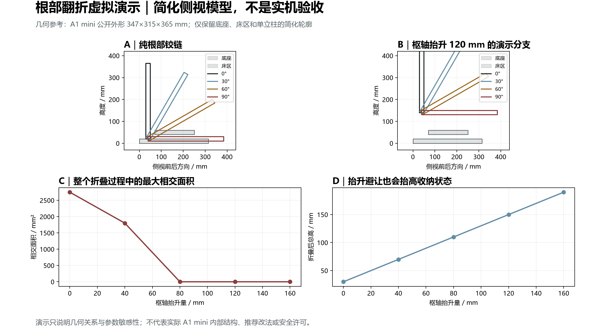

# 虚拟验证：根部翻折参数化演示

日期：2026-11-12

## 一、这次实际做了什么

使用 A1 mini 公开外形尺寸 **347×315×365 mm** 建立了一个简化侧视模型，只保留：

- 底座轮廓；
- 一个简化的床区障碍；
- 单立柱轮廓；
- 可设置的根部转轴和枢轴抬升量。

对 0–90° 折叠过程进行逐 2° 检查，比较枢轴抬升 0／40／80／120／160 mm 时的相交面积与折叠外包络。

**这是虚拟方法演示，不是实际 A1 mini 的装配验证。**床区位置、立柱截面和转轴位置都是演示假设，不能据此加工零件。

## 二、结果

| 枢轴抬升量 | 模型中的最大相交面积 | 首次出现相交的角度 | 折叠后模型总高 |
|---:|---:|---:|---:|
| 0 mm | 2750 mm² | 2° | 30 mm |
| 40 mm | 1800 mm² | 72° | 70 mm |
| 80 mm | 0 mm² | 未出现 | 110 mm |
| 120 mm | 0 mm² | 未出现 | 150 mm |
| 160 mm | 0 mm² | 未出现 | 190 mm |

## 三、可以得出的有限结论

1. **纯根部铰链需要认真检查底座与床区干涉。**在这组简化几何中，折叠早期就出现了相交。
2. **避让与收纳高度存在直接权衡。**抬升枢轴可以减少模型相交，但也提高收纳状态。
3. F04／F10 的“先抬离或偏移，再翻倒”因此值得进入参数化比较，但不能仅凭这次演示选择它们。
4. 80 mm 及以上的“零相交”只在这两个简化障碍和这组假设下成立，不代表线缆、工具头、料盘、锁紧件或真实底座都安全。

## 四、不能得出的结论

- 不能说 80 mm 是实际推荐抬升量；
- 不能说折叠后的精度、刚度或安全性已验证；
- 不能把模型中的 30／110／150 mm 写成真实产品的收纳高度；
- 不能用这次虚拟演示代替实体折叠样机与恢复打印。

## 五、下一轮模型需要替换的内容

1. 用实机测量或可靠 CAD 替换立柱、底座和床区的简化多边形；
2. 加入横臂、工具头、料盘、线缆和锁紧件；
3. 用实际枢轴与连杆尺寸建立 F04 四连杆和 F10 槽轨模型；
4. 加入根部载荷、锁点位置与展开后参考点；
5. 将模型结果与一次真实折叠动作对照后，再确定机构参数。

## 六、复现与来源

- 生成代码：`scripts/virtual_root_fold_demo.py`
- 原始结果：`data/virtual_root_fold_demo.csv`，230 行；
- 结果图：`evidence/virtual_root_fold_demo.png`；
- 尺寸来源：[A1 mini 官方规格 PDF](https://csm.bblcdn.com/hub/38bb17f644684161ac03fb0eabaa066f.pdf)；
- 计算环境：Python、Shapely、Matplotlib；所有计算均可由脚本重新生成。
