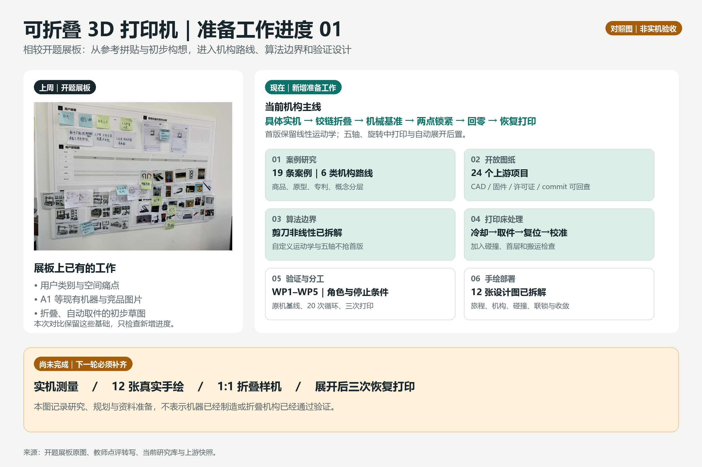

# 进度对比 01：相较开题展板的变化

## 相较展板，新增了什么

1. **机构主线**：从零散的折叠与取件构想，收敛到“具体实机→铰链折叠→机械基准→两点锁紧→回零→恢复打印”。
2. **案例结构**：19 条案例按商品、原型、概念和专利分层，并形成六类机构路线。
3. **可回查资料**：24 个上游项目记录 commit、分支、许可证和用途，补入 Trident 与 Prusa 图纸。
4. **算法边界**：首版保留线性运动学；剪刀非线性、五轴与自动展开不再混入首版。
5. **打印床处理**：补入冷却、取件、复位、碰撞、首层与搬运检查。
6. **执行与验证**：形成工作包、角色分工、停止条件和 12 张手绘图任务。

## 进度边界

这是一张**准备工作进度图**，不是原型验收图。实机测量、真实手绘、1:1 折叠样机和展开后的三次恢复打印仍未完成。

## 来源与生成

- 原始展板：`evidence/开题展板_原始.jpg`，仅缩放用于对照，未修改内容。
- 输出图片：`evidence/进度对比_01.png`，2400×1600 px，RGB，150 dpi 元数据。
- 生成代码：`scripts/render_progress_01.py`。
- 事实来源：当前研究库、教师点评整理、案例表和上游项目快照。
