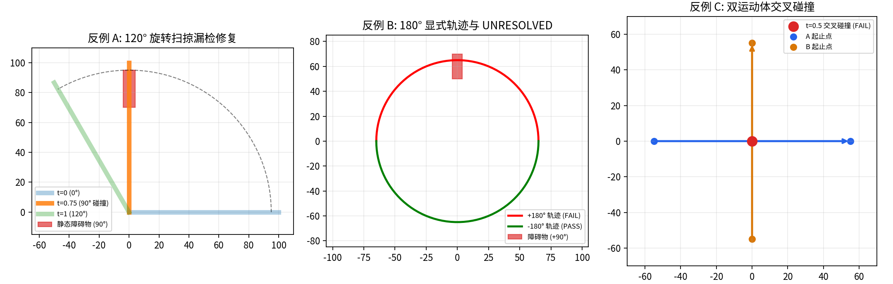
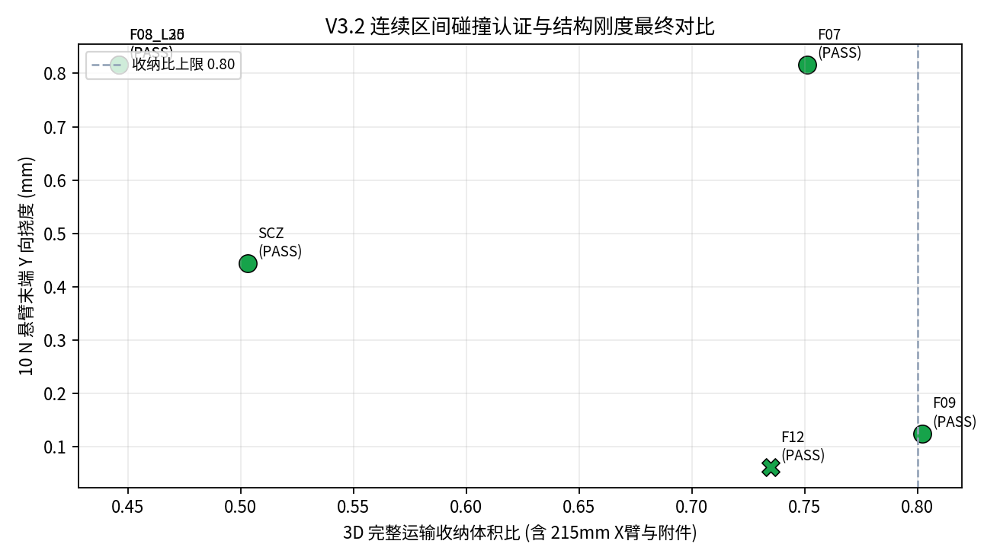

# 可折叠 3D 打印机｜V3.2 连续碰撞修复与终审定型报告

## 1. 版本定位

V3.2 是第三轮虚拟终审的最后一次软件修复，目标为：
1. 修复 V3.1 Final 中 `geometry3d.py` 旋转扫掠包络裕量不足及 180° 旋转轴退化问题。
2. 通过 5 组回归反例（A–E）验证连续碰撞内核的数学保守性与完备性。
3. 使用连续区间自适应二分认证重跑 F09、F07、SCZ、F08、F12 的实际机构轨迹，冻结最终线下实物验证名单。

## 2. 连续碰撞算法修复摘要

- **15 轴精确 SAT (`obb_sat_distance`)**：保留 `SAT_TOL = 1e-9`，输出保守欧氏分离下界 `clearance_mm`。
- **180° 退化保护 (`_screw_interp_pose` & `swept_obb_vs_obb`)**：当旋转角 `angle >= pi - 1e-3` 且无显式关节轨迹时，拒绝猜测旋转轴与方向，直接返回 `UNRESOLVED`。
- **Lipschitz 连续区间二分认证 (`verify_interval_collision`)**：基于显式连续轨迹 `pose_a(t), pose_b(t)`，在每个子区间 `[ta, tb]` 计算中点姿态分离距离与 Lipschitz 运动上界 `margin = U_a + U_b`；仅当 `clr > margin + tol` 时认证 `PASS`，遇到静态碰撞立即返回 `FAIL`，达到 `max_depth` 仍无法证明分离时返回 `UNRESOLVED`。

## 3. 候选机构 V3.2 重验汇总

| 候选 | 定位 | 连续碰撞 | 3D 收纳比 | 折叠最大尺寸 (mm) | 最小认证净距 (mm) | 10N Y向挠度 (mm) |
| :--- | :--- | :--- | :---: | :---: | :---: | :---: |
| **F09** (`lift=85, shift=0, arm_fold=1`) | 主力实体验证 | **PASS** | 0.802 | 587.0 (`587.0×347.0×157.0`) | 0.063 | 0.1252 |
| **F07** (`lift=75, shift=0, arm_fold=1`) | 有条件备选 | **PASS** | 0.751 | 587.0 (`587.0×347.0×147.0`) | 0.053 | 0.8166 |
| **SCZ** (`arm=154, h_fold=45`) | 仅限台架机构验证 | **PASS** | 0.503 | 549.0 (`315.0×549.0×105.0`) | 0.006 | 0.4446 |
| **F08** (`lift=25, shift=-75`) | 工程兜底备选 | **PASS** | 0.446 | 897.0 (`897.0×347.0×79.0`) | 0.019 | 0.8166 |
| **F08** (`lift=30, shift=-75`) | 工程兜底备选(+5mm) | **PASS** | 0.446 | 897.0 (`897.0×347.0×79.0`) | 0.022 | 0.8166 |
| **F12** (`overlap=52, outer=60`) | 淘汰归档 | **PASS** | 0.735 | 549.0 (`315.0×549.0×169.7`) | 0.002 | 0.0612 |

